# StarLux SLM Open Source

本目录收录 StarLux SLM 1.1.9 及更早版本的公开源码、工具、文档和素材。欢迎其他开发者依据 [MIT 许可证](LICENSE) 及各组件随附许可拓展或接入；原有源码与内部目录结构保持完整。所有版本的公开发布与附件仍可从 [Releases](https://github.com/Starlux531/StarLux-Landing-Meter/releases) 获取。

Published source, tools, documentation and assets for StarLux SLM 1.1.9 and earlier. Developers may extend or integrate these materials under the accompanying MIT and component licenses. Existing version tags and release assets remain available.

1.2.0 起的 Flare 模块范围见 [发行说明](../DISTRIBUTION.md)。

---

# StarLux Landing Meter · 1.1.9RC9

**1.1.9RC9 公开稳定发行 · 2026-10-10，配套安装器 1.0.4。** 本次汇总公开版 RC4 之后的接地观察与弹跳修复、触地弹窗和即时演算、实时 G/FPM、默认 OSM 底图、兼容版英文界面、导出优化及安装器体验改进。

**[下载中文版 / Chinese bundle](https://github.com/Starlux531/StarLux-Landing-Meter/releases/download/v1.1.9RC9/StarLux_LMM_Installer_1.1.9RC9_CN.zip)** · **[Download English bundle](https://github.com/Starlux531/StarLux-Landing-Meter/releases/download/v1.1.9RC9/StarLux_LMM_Installer_1.1.9RC9_EN.zip)** · [全部发行附件 / All assets](https://github.com/Starlux531/StarLux-Landing-Meter/releases/tag/v1.1.9RC9)

CN/EN 均含 Standard/Compatibility × 中/英文四种载荷。Standard 要求 XP 12.4.4+；Compatibility 游戏内英文，报告中英可选。请完整解压并安装，不要仅替换 Lua。已有用户可先更新安装器，再安装 RC9；保留配置会继承其他个人偏好。

**Public stable release 1.1.9RC9**, bundled with installer **1.0.4**. This cumulative update adds bounded touchdown observation, rebound fixes, live recorder status and source-labeled widgets, an enabled-by-default OSM plan view, clearer G review and adaptive report export. CN and ASCII-path EN bundles contain all four variants. Update the installer first, then install the complete plugin package.

[累计更新 / Changelog](CHANGELOG.md) · [中英文发行说明 / Release notes](RELEASE_NOTES_v1.1.9RC9.md) · [安装说明 / Installation](README_1.1.9.md) · [路线图 / Roadmap](ROADMAP.md)

下一版本直接进入 **1.2.0 原生 XPL 重写**，为多平台移植打基础；1.1.x 不再安排后续错误修复版本。The next release line is the native XPL rewrite in 1.2.0; no further 1.1.x bug-fix releases are planned.

## RC9 新版预览 / RC9 previews

### 触地弹窗与观测峰值 / Touchdown popup and observed peak

弹窗显示带来源的 FPM、着陆 G 与单独保留的观测峰值；即时演算提前显示记录状态，触地后展开完整结果。

Source-labeled FPM, landing G and the observed peak appear together. Live calculation starts with recorder status and expands at touchdown.

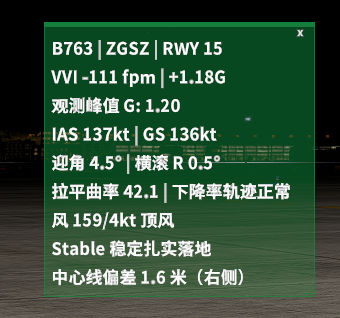

### OSM 地图与同步复盘 / OSM map and synchronized review

默认启用 OSM、路径风向与竖向细节，支持独立放大及同步播放；截图展示用户切换至 LOC 几何参考并放大的视图，并非初始默认倍率。

OSM, wind along track and vertical detail start enabled, with independent enlargement and synchronized playback. This screenshot shows a zoomed-in LOC-reference view; the default side view is wind, with an initial map scale of 0.71×.

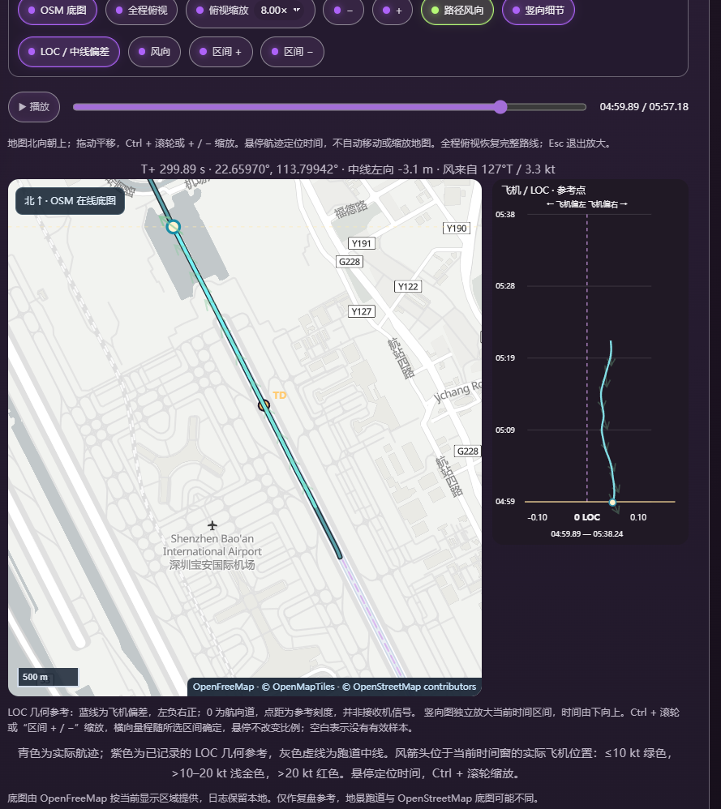

### 为什么显示 G 区间 / Why show a G range?

接地载荷会随着轮胎接触、起落架压缩和可能的再次触地而变化，单一读数容易隐藏后续峰值。RC9 并列显示报告中的触地读数与接地事件观测峰值，并以双指针连接，方便看清两者差距。因此它比孤立的一个数值提供了更多可核查的接地信息；该区间不是统计置信区间，原始观测峰值也不直接替代评分 G，评分继续结合既有 FPM/G 规则。网页“触地瞬时”目前沿用报告显示字段，不代表重新提取了原始触地单帧。

Landing load changes through wheel contact, gear compression and possible subsequent contacts. A single reading can hide a later peak. RC9 shows the report's touchdown display value alongside the observed touchdown-event peak, connected by two markers, making their difference visible and easier to inspect. This provides more context than one isolated number; it is not a statistical confidence interval, and the raw peak does not automatically replace the rated G. Existing FPM/G grading remains unchanged. “Instantaneous touchdown” currently uses the report display field, not a newly extracted touchdown-frame sample.

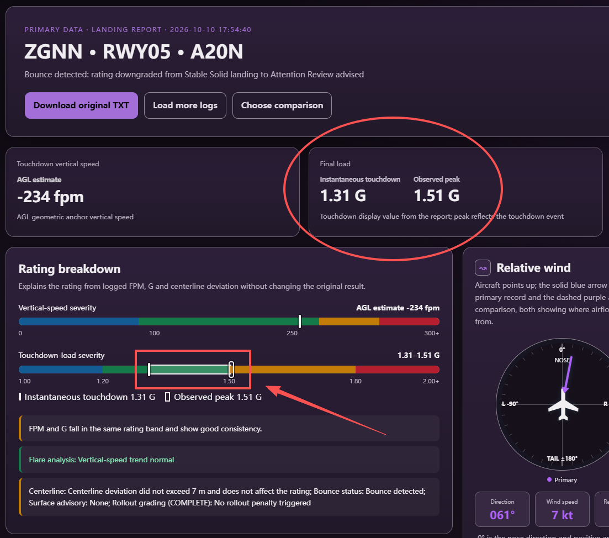

### 即时演算动态演示 / Live-calculation demonstrations

作者提供的原始动画，中文约 62 MB、英文约 95 MB；加载速度取决于网络。既有图集保留在下方。

Original user-supplied animations, approximately 62 MB (CN) and 95 MB (EN). Loading depends on the connection; the existing gallery remains below.

| 文件或目录 | 用途 |
| --- | --- |
| `StarLux_LMM_v1.1.9.lua`、`LMM_UI_119/` | 当前主脚本、运行模块与字体 |
| `LMM_Report_Reader.html` | 插件报告分析器 |
| `Starlux_Analyzer_落地分析器.html` | 独立网页分析器 |
| `development.json` | 当前版本和稳定 / 开发通道 |
| `tools/`、`tests/`、`installer/` | 构建与验证工具、安装器源码 |

以下为保留的历史图集，部分来自 1.1.8；当前行为以上方 RC9 说明为准。 / Preserved historical gallery; current behavior is described above.

## 动态演示 / Interactive charts in motion

100 ft 轨迹、操纵输入、舵面响应和动力输出共用时间轴，鼠标指向可同步读数；支持播放、拖动进度与融合／分离视图。

Trajectory, controls, surfaces and power output share one timeline, with synchronized hover readouts, playback, scrubbing and fused/separated views.

  <a href="docs/images/316f279efdc4f5dd509f893750489b25.gif">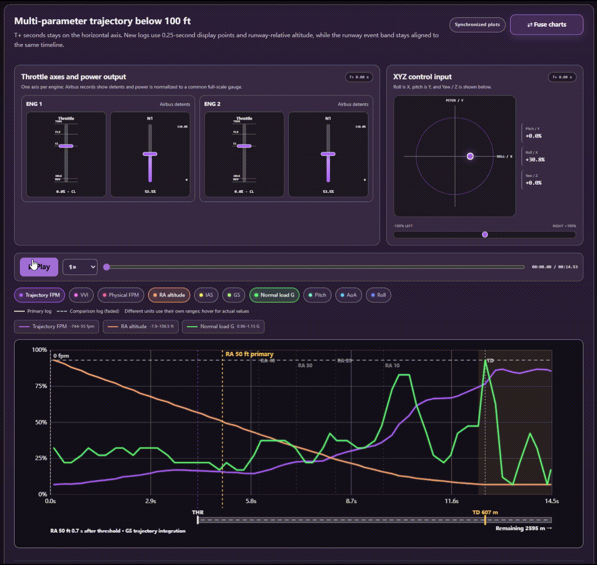</a>

作者提供的原始 GIF，约 10 MB。点击查看原图。 / Original author-provided GIF, about 10 MB; click to view.

## 报告总览 / Landing report overview

接地读数、评分来源、相对风、姿态、真实跑道位置与操作曲线集中复盘。网页颜色由 RGB 自动生成，也可保存缩放、布局与曲线选择。

Review touchdown values, rating sources, wind, attitude, runway geometry and control traces together. RGB themes and saved presets include zoom, layout and selected curves.

  <a href="docs/images/2b87968938e5c0083bf0713c2a316422.png">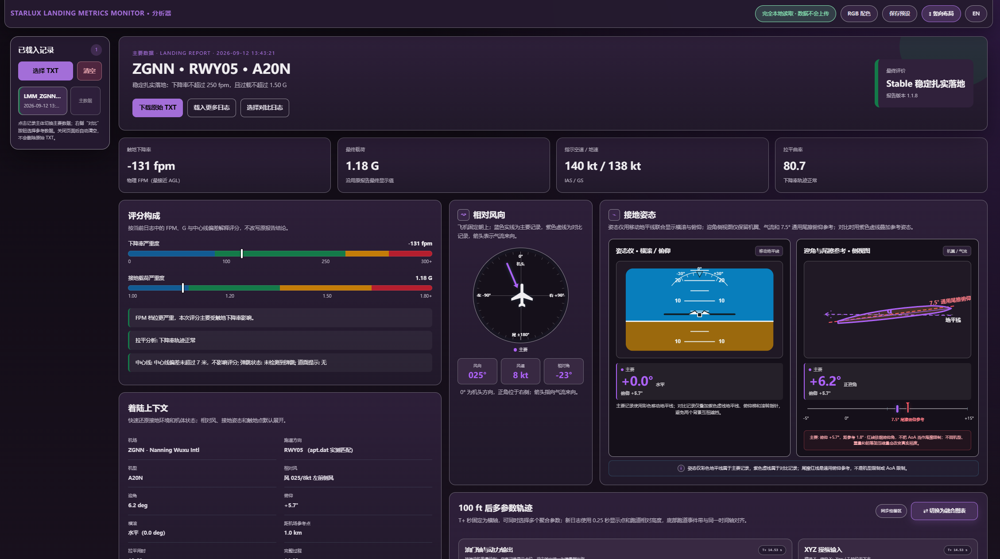</a>

## 游戏内设置与记录 / In-simulator settings and records

两个独立菜单入口；设置按通用、位置、配色、字体、工具分区，记录窗口区分打开、删除确认与翻页。下面是标准版的作者实机截图，设置图左侧为预览弹窗，不是一次有效落地结果。

Separate Settings and Landing records menus, grouped settings, visible slider handles and confirmed deletion. These are author-provided standard-edition screenshots; the popup in the Settings screenshot is a preview, not a recorded landing.

<table>
  <tr><th width="55%">设置与弹窗预览 / Settings &amp; popup preview</th><th width="45%">落地记录 / Landing records</th></tr>
  <tr>
    <td valign="top"><a href="docs/images/ad0467ff32bf49a97a8ff26e8333cb02.png">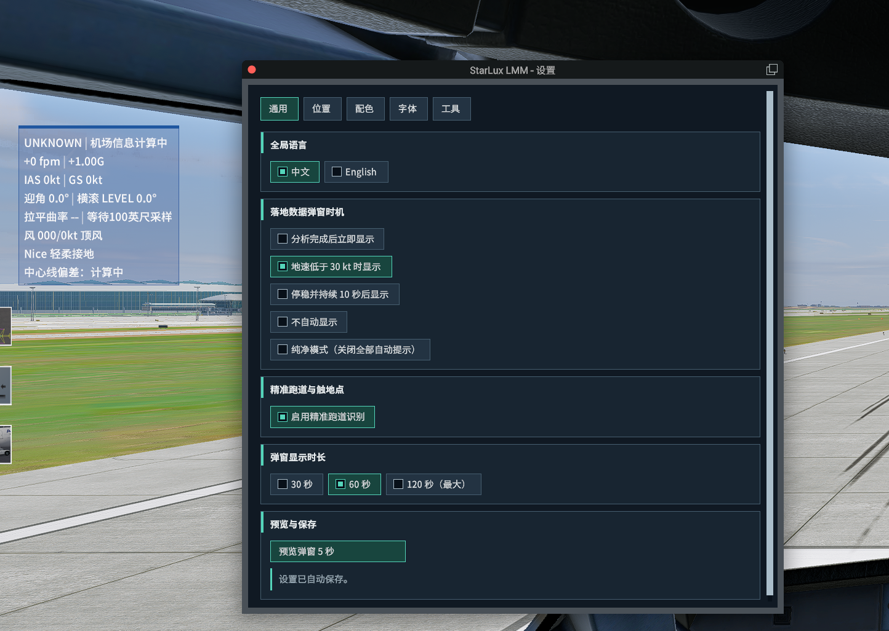</a></td>
    <td valign="top"><a href="docs/images/4bf29d926c0911c3946c5de9234a522b.png">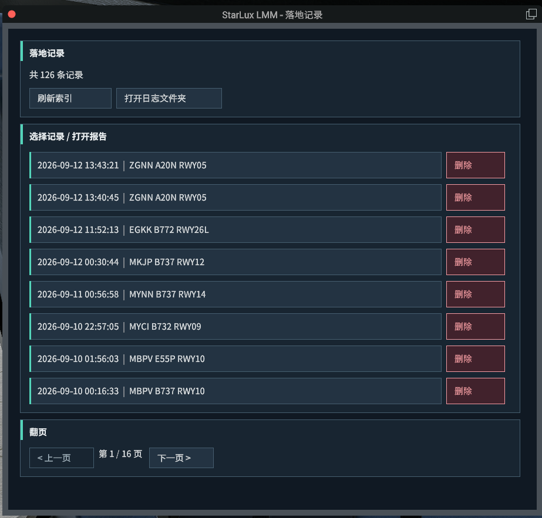</a></td>
  </tr>
</table>

## 完整图集：配色、英文界面和原始数据 / Full gallery: themes, English UI and raw data

### 完整复盘页面 / Complete dashboards

长截图并排展示不同配色和语言，点击可查看原分辨率。英文界面可加载中文历史报告，原始 TXT 保持原文。

Click either full-page screenshot for original resolution. English UI can load historical Chinese reports; the raw TXT remains unchanged.

<table>
  <tr><th width="50%">青色主题 / Cyan theme</th><th width="50%">英文紫色主题 / English violet theme</th></tr>
  <tr>
    <td valign="top"><a href="docs/images/6e496966fbd47394b60dcc42b4c3ff50.png">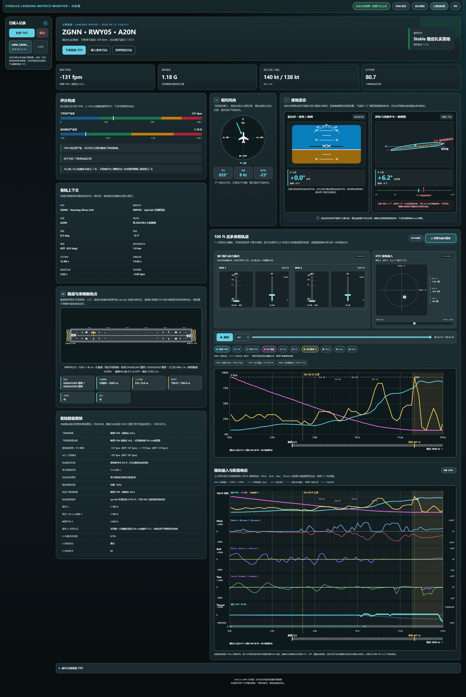</a></td>
    <td valign="top"><a href="docs/images/5e6e9a8769d7caa1d042a6136d0aa93e.png">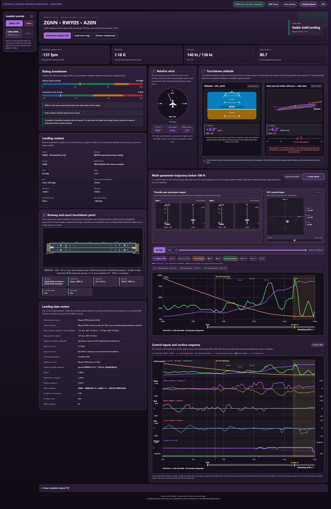</a></td>
  </tr>
</table>

### 可核对的原始记录 / Inspectable source records

保留 TXT 聚合轨迹表，方便核对每个时间点的数据，不改写原始记录。

The original aggregated TXT trace remains available for checking recorded samples.

  <a href="docs/images/389431ad037fa71f20b03bb7768d3164.png">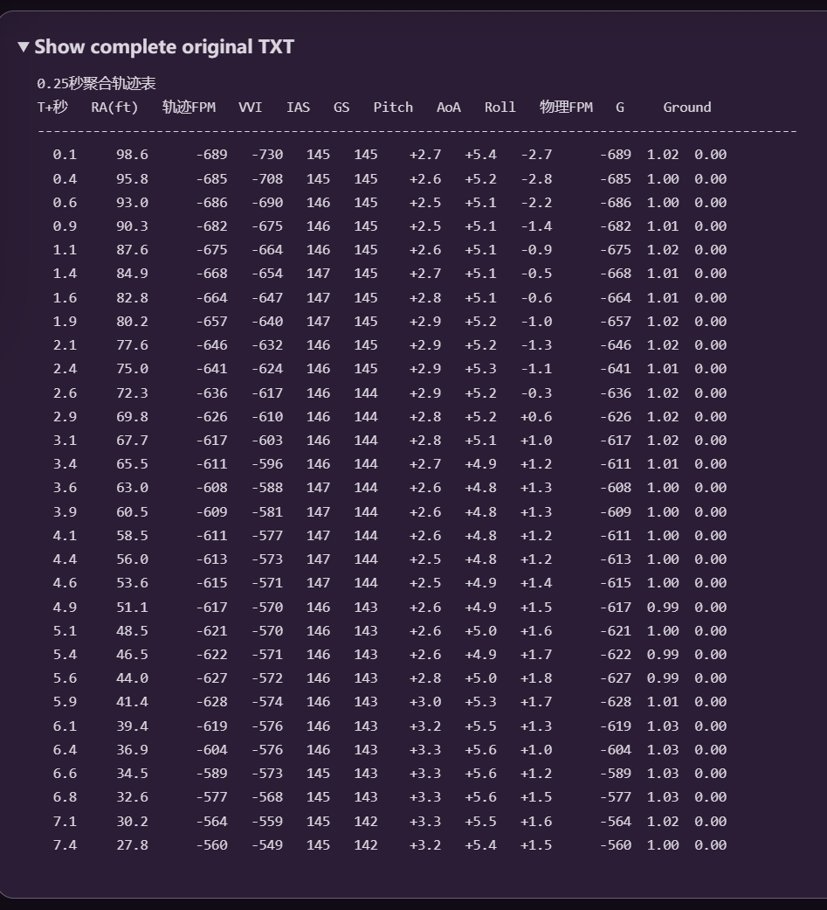</a>

## 完整进近与滑跑复盘 / Full approach and rollout analysis

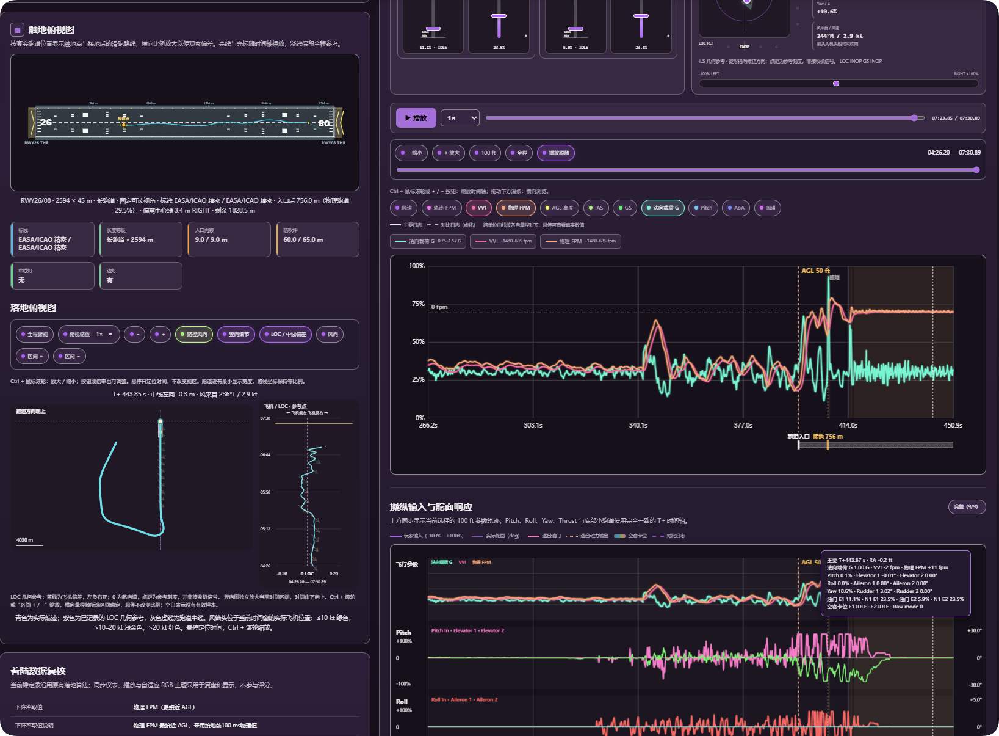

## 触地俯视图 / Touchdown plan view

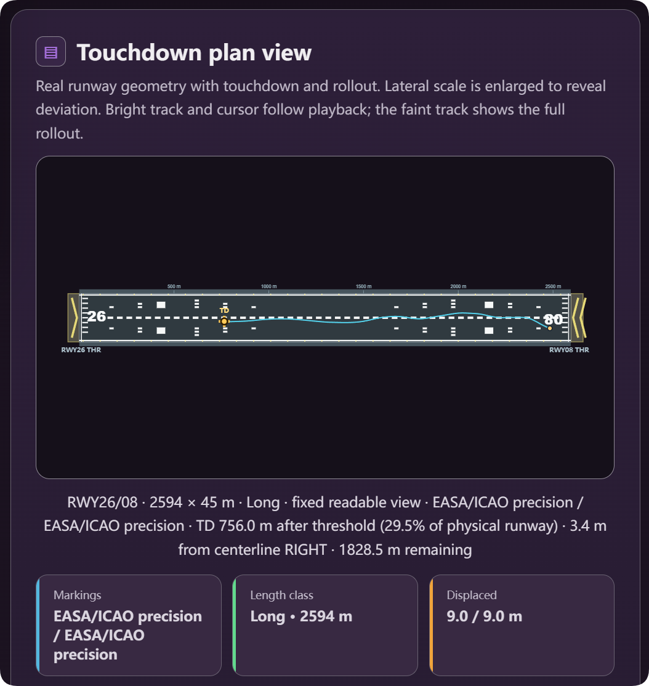

## 当前能力 / Features

- **接地过程**：完整记录跟随接地与滑跑直至地速低于 30 kt 连续两秒；弹跳监测不再受 6 秒／100 ft 短窗限制。FPM 保留物理、VVI、AGL 的来源复核，G 保留短峰稳健窗口，并针对有证据支持的延迟峰进行有界接地观察。
- **操纵与动力**：三轴输入、实际舵面、逐发动机油门和 N1 等输出；按可用机模数据源适配，区分空客卡位与普通油门。缺失数据不假装已测得。
- **机场索引**：持久缓存、增量更新、按帧预算处理和进度提示；利用真实 apt.dat 几何匹配跑道与触地点。匹配失败保留状态，不猜测结果。
- **插件 UI**：标准版中英文、原生中文字号与字重、自定义评级颜色、九宫格及四向微调；报告生成提示融入落地弹窗。
- **分析器**：主／对比记录、同步仪表、最低 0.25× 播放、进度拖动、融合／分离图、横向布局、独立缩放与自适应 RGB 配色。
- **作者预设**：默认、黑暗玫瑰、巨峰葡萄、未来展厅、水晶紫罗兰。首次使用时提供，不覆盖已有保存列表；英文界面保留预设原名。

Complete touchdown/bounce capture; traceable FPM/G sources; control and engine traces; persistent incremental airport indexing; bilingual native UI; synchronized comparison and playback; configurable RGB themes and five author-approved presets. Data availability depends on aircraft and simulator interfaces.

## 评分与边界 / Rating and limitations

| 评价 / Rating | 下降率绝对值 / Descent-rate magnitude | 载荷 / Load |
| --- | ---: | ---: |
| Nice 轻柔接地 | ≤ 100 fpm | ≤ 1.20 G |
| Stable 稳定扎实落地 | ≤ 250 fpm | ≤ 1.50 G |
| Attention 需注意 | ≤ 300 fpm | ≤ 1.80 G |
| UNSTABLE 不良落地 | 超过上述上限 / Above the limits | 超过上述上限 / Above the limits |

FPM 与 G 取较严重等级，不互相抵消。成功匹配跑道后应用中心线修正：超过 7 m 在非红等级内降一级，超过 15 m 进入 UNSTABLE；弹跳沿用既定修正规则。操纵曲线与拉平曲率仅用于复盘，不参与评分。图中 7.5° 尾擦线是通用俯仰参考，不是具体机型限制。

FPM and G use the more severe band, followed by existing centerline/bounce adjustments. Control traces and flare curvature are review-only. The 7.5° tail-strike line is a generic pitch reference, not an aircraft-specific limit. **For flight simulation only—not maintenance, airworthiness or operational guidance.**

## 数据、更新与隐私 / Data and privacy

可选地图会联网请求 OpenFreeMap 底图，保留地图数据归属标注；报告、设置和机场缓存留在本机；插件和分析器不上传飞行数据。安装器联网查询官方 GitHub／Gitee Releases、下载发行包；Windows 插件也会后台查询官方 GitHub 发行元数据以提示更新。下载包不含作者的飞行 TXT、浏览器日志或个人配置；作者明确授权展示的截图与配色预设除外。

The optional map requests basemap data from OpenFreeMap and retains attribution. Reports/settings/cache stay local. The installer contacts official release sources; the Windows plugin also checks official GitHub release metadata for update notices. Packages exclude personal flight TXT files and browser data; screenshots and sanitized appearance presets are explicitly author-approved. The installer is not yet code-signed; see the [installation guide](README_1.1.9.md) for safeguards and limitations.

## 文档与反馈 / Documentation and feedback

- [1.1.9 开发与兼容说明 / Installation and compatibility](README_1.1.9.md)
- [安装器开发与构建 / Installer development](installer/README.md)
- [更新记录 / Changelog](CHANGELOG.md)
- [1.1.4 历史发布说明 / Archived release notes](旧版备份/2026-09-13_1.1.9开发前整理/v1.1.8-baseline/RELEASE_NOTES_v1.1.4.md)
- [1.1.4 核心版本总结 / Historical technical summary](旧版备份/2026-09-13_1.1.9开发前整理/v1.1.8-baseline/docs/StarLux_LMM_v1.1.4_稳定测试版项目总结报告.md)
- [贡献指南 / Contributing](CONTRIBUTING.md)

报告问题时请附 XP、FlyWithLua、LMM、机模版本，是否回放／暂停，触地前后帧率，以及对应 TXT（分享前检查个人信息）。脚本被隔离时同时提供 `[StarLux LMM]` 日志。三至五份不同落地条件的报告有助于定位系统性偏差，单张 FPM/G 截图不能替代原始记录。

For bug reports, include versions, aircraft, replay/pause status, frame rate and the corresponding TXT after checking it for personal information. Include LMM log lines if the script is quarantined. Multiple varied landings help diagnose systematic differences.

## 许可证 / License

代码采用 [MIT License](LICENSE)，随包 LMM UI 字体采用 [SIL OFL 1.1](LMM_UI_119/fonts/OFL.txt)。X-Plane、FlyWithLua 等名称归其权利人所有，本项目与其官方开发者无隶属关系。

Code: MIT. Bundled fonts: SIL OFL 1.1. This project is not affiliated with the X-Plane or FlyWithLua developers.
